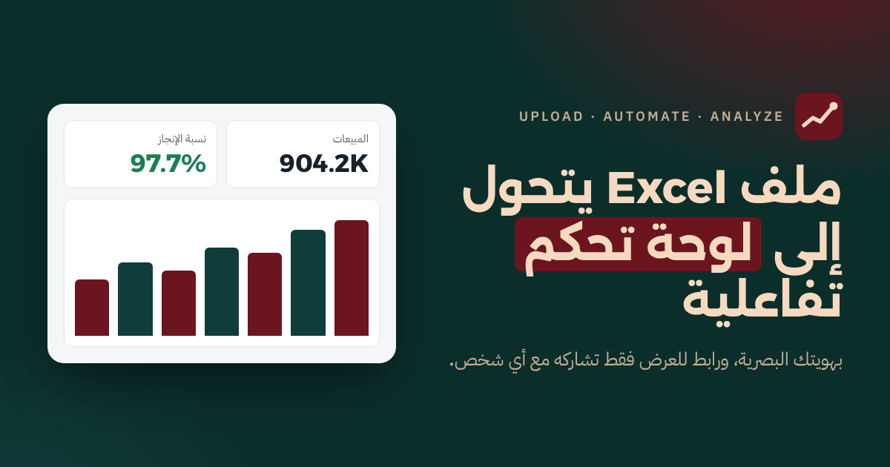
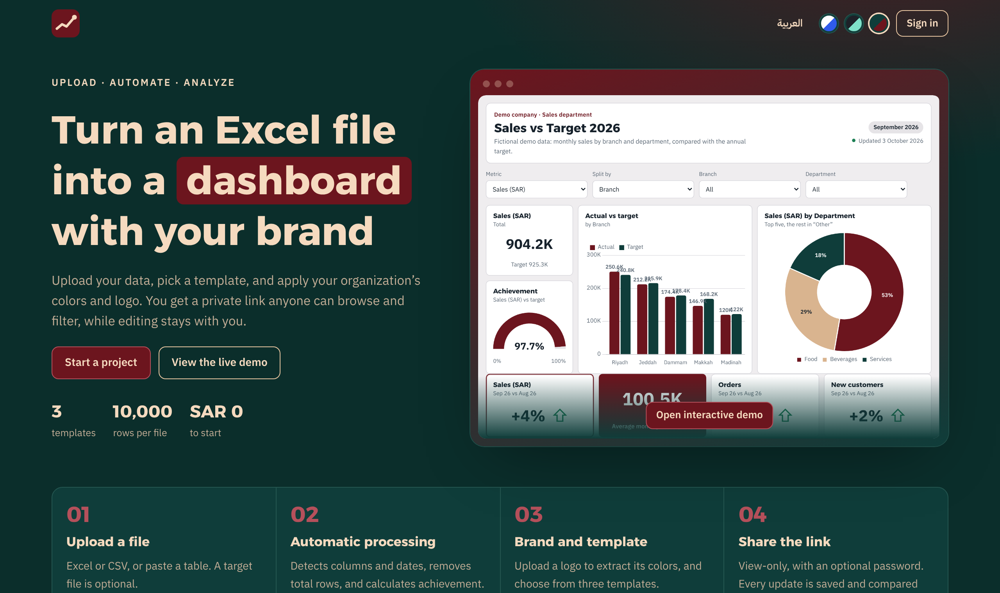
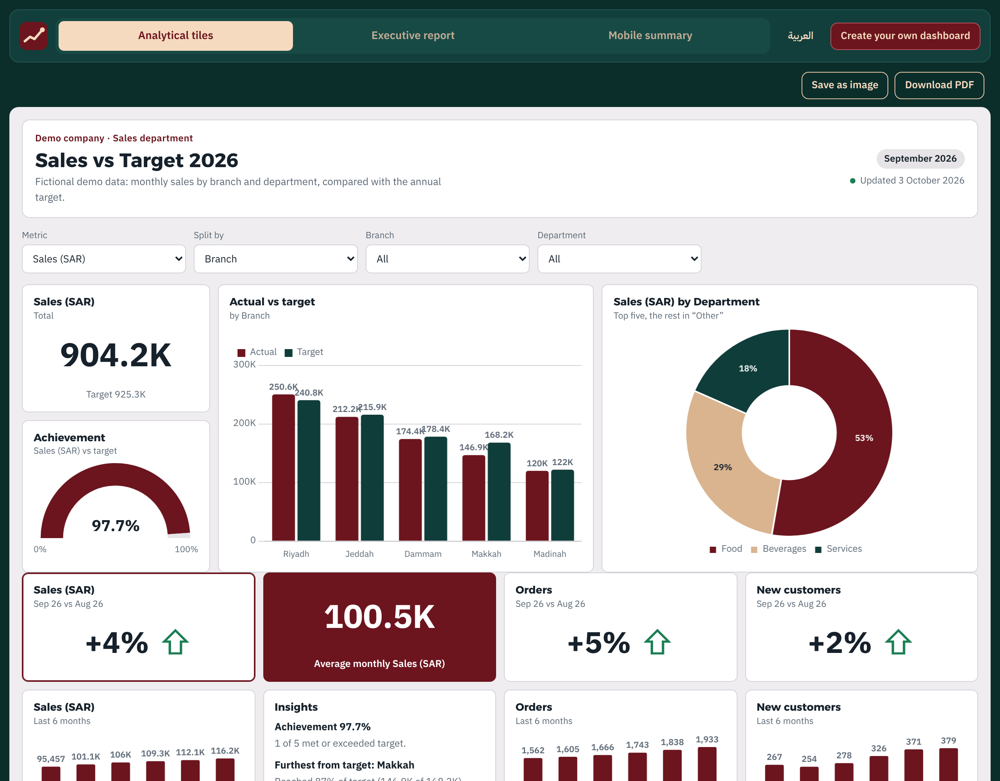
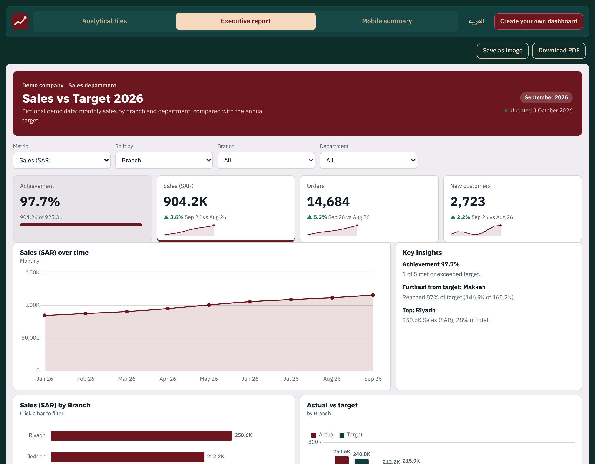
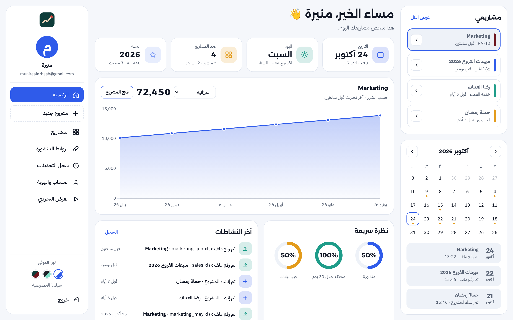
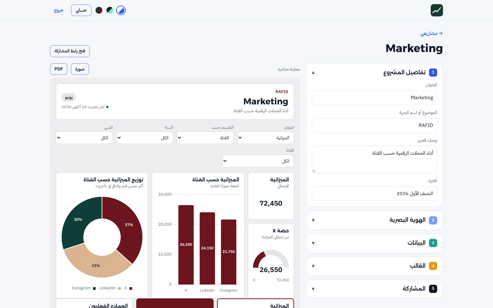
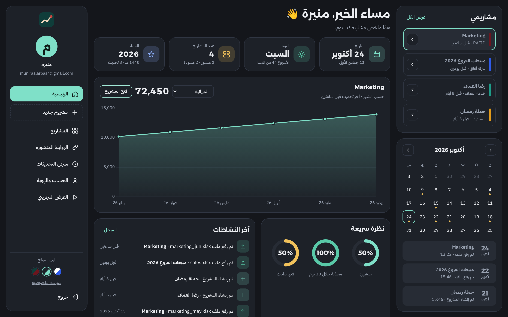
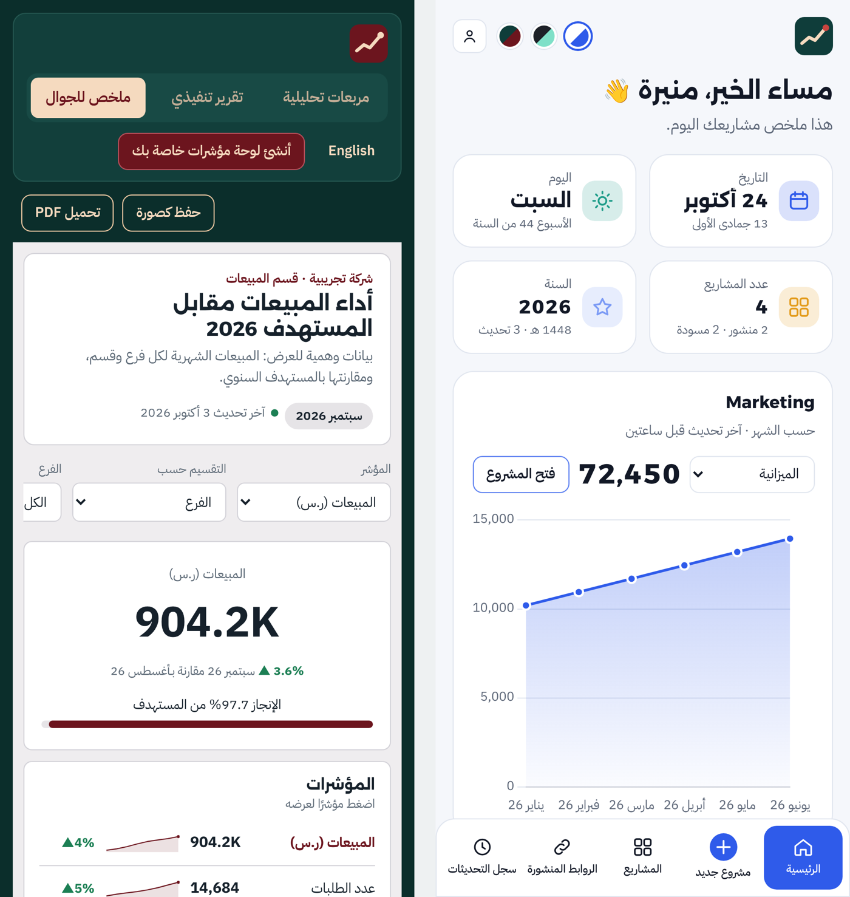
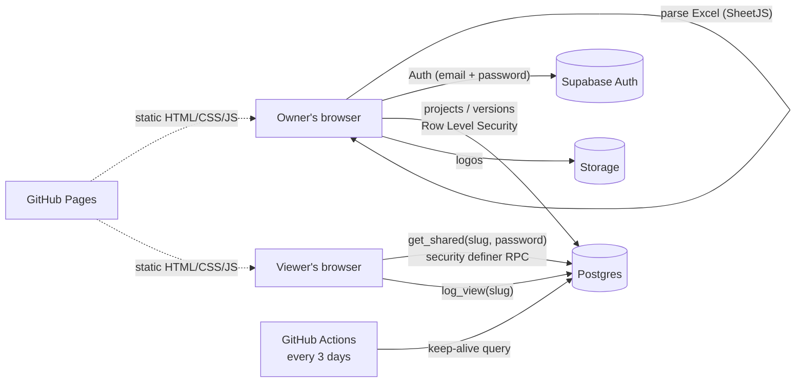

<div align="center">



# Dashboard · لوحة المؤشرات

**Upload. Automate. Analyze.**

Turn an Excel file into a branded, interactive dashboard and share it through a view-only link.

[**Live demo (English)**](https://muniraalarbash-pixel.github.io/dashboard/view.html?demo=1&lang=en) ·
[**Website**](https://muniraalarbash-pixel.github.io/dashboard/?lang=en) ·
[**العرض التجريبي بالعربي**](https://muniraalarbash-pixel.github.io/dashboard/view.html?demo=1&lang=ar) ·
[العربية ↓](#-بالعربي)

</div>

---

## The problem

Teams share performance numbers as Excel attachments or static screenshots. Every month someone rebuilds the same charts, the file goes out of date the moment it is sent, and people outside the organization cannot use tools like Power BI without licenses.

**Dashboard** removes that loop: upload the monthly Excel file, and the same link updates for everyone, with the organization's own colors and logo, in Arabic or English.

## Features

| | |
|---|---|
| **Smart Excel import** | Reads `.xlsx` / `.csv` or a pasted table in the browser. Detects column types (date, number, category, text), understands Arabic digits and month names, “SAR / ر.س” values, and drops “Total” rows so nothing is double-counted. |
| **Target vs actual** | Upload a target file and the app joins it to the data and computes achievement % per branch or department. |
| **Three templates** | Analytical tiles, executive report, and a mobile summary, all from the same data model. |
| **Brand identity** | Upload a logo and its dominant colors are extracted automatically; choose from six Arabic-friendly fonts. |
| **Interactive for viewers** | Filters, metric switcher, click-to-filter charts, sortable/searchable table, period-over-period change, auto-generated insights. |
| **Versioned updates** | Every upload is kept; KPIs compare with the previous period or upload, and shared links refresh automatically. |
| **Secure sharing** | View-only public link, optional password (bcrypt), on/off at any time, per-day view counter that ignores the owner’s own visits. |
| **Export** | Save any dashboard as PNG or as a print-ready PDF (A4 landscape). |
| **Personal workspace** | Greeting, date tiles (with Hijri date), chart of the selected project, activity feed, event calendar, published links, upload history, default brand. |
| **Bilingual & themed** | Full Arabic (RTL) and English (LTR) for public pages; light, dark and bordeaux site modes; responsive down to 360 px. |

## Screenshots

| Landing page | Analytical tiles template |
|---|---|
|  |  |

| Executive report template | Personal workspace (Arabic) |
|---|---|
|  |  |

| Project editor with live preview | Workspace in dark mode |
|---|---|
|  |  |

<p align="center"></p>

## Architecture

A serverless architecture: a static front-end on GitHub Pages and a Backend-as-a-Service (Supabase). The Excel file never leaves the browser; only the parsed table is stored.



### Data model

| Table | Purpose |
|---|---|
| `projects` | Title, topic, description, template, brand (JSON), target mapping, share slug, published flag, hashed share password, view totals |
| `versions` | One row per upload: parsed data and targets (JSONB), totals, row count, period, file name |
| `share_views` | Daily view counts per project |

### Security

- **Row Level Security** on every table: a user can only read and write their own rows, enforced by the database, not the UI.
- **Public access only through two `security definer` functions** (`get_shared`, `log_view`) that return the latest published version and nothing else.
- **Share passwords hashed with bcrypt** (`pgcrypto`); never stored or returned in plain text.
- **Storage policies**: each user can only write inside a folder named after their user ID.
- **Only the publishable key is in the client**; the service key is never used in the front-end.
- **HTTPS everywhere** (GitHub Pages + Supabase).

**Known limitations:** email confirmation is off (the free email tier is rate-limited, planned with a custom domain), no rate limiting on share-password attempts, no MFA, and the database region is Tokyo, so data subject to in-Kingdom hosting rules (PDPL) should be aggregated or anonymized.

## Tech stack

`HTML` · `CSS` (custom properties, container queries, RTL/LTR logical properties) · `JavaScript` (ES modules, no framework) · `Chart.js` · `SheetJS` · `html-to-image` · `Supabase` (Auth, Postgres, Storage, RLS, RPC) · `GitHub Pages` · `GitHub Actions`

## Project structure

```
index.html            Landing page, sign in / sign up, forgot password
app.html              Personal workspace (home, projects, links, history, settings)
project.html          Project editor: details, brand, data & targets, template, sharing
view.html             Public view-only dashboard and the live demo (?demo=1)
reset.html            Set a new password from the email link
privacy.html          Privacy policy (Arabic / English)
assets/js/parse.js    Excel/CSV parsing, type detection and cleaning
assets/js/engine.js   Data model, aggregation, insights, targets, brand theming, i18n helpers
assets/js/render.js   The three dashboard templates and charts
assets/js/home.js     Personal workspace
assets/js/project.js  Project editor
assets/js/export.js   PNG / PDF export
assets/templates/     Sample Excel files (sales, marketing)
supabase/             Database schema and migrations
.github/workflows/    Keep-alive job for the free database tier
```

## Run your own copy

1. Create a project on [Supabase](https://supabase.com) and run, in **SQL Editor**, `supabase/schema.sql` then `supabase/migration-002-views.sql`.
2. Put your **Project URL** and **publishable key** in `assets/js/config.js` (and in `.github/workflows/keep-alive.yml`).
3. In Supabase → Authentication → URL Configuration, set the Site URL to your site and add `https://<your-site>/**` to Redirect URLs.
4. Enable **GitHub Pages** (branch `main`, folder `/root`).

## Roadmap

- Custom domain and email confirmation
- Self-service account deletion
- English for the signed-in workspace
- Optional AI-written summary of each dashboard

---

<div dir="rtl">

## 🇸🇦 بالعربي

**لوحة المؤشرات** موقع يحوّل ملف Excel إلى لوحة مؤشرات تفاعلية بهوية الجهة البصرية، وتشاركها برابط للعرض فقط.

### المشكلة اللي يحلها
الأرقام تنرسل كمرفقات Excel أو صور ثابتة، وكل شهر أحد يعيد بناء نفس الرسوم، والجهات من خارج الشركة ما تقدر تستخدم أدوات مثل Power BI بدون تراخيص. هنا ترفع ملف الشهر، والرابط نفسه يتحدث للجميع.

### المميزات
- **قراءة ذكية للملف:** يتعرف على أنواع الأعمدة، ويفهم الأرقام العربية وأسماء الأشهر و«ر.س»، ويحذف صفوف الإجمالي. الملف نفسه ما يُرفع؛ يُقرأ داخل المتصفح.
- **المستهدف مقابل الفعلي:** نسبة الإنجاز لكل فرع أو قسم.
- **ثلاثة قوالب:** مربعات تحليلية، تقرير تنفيذي، ملخص للجوال.
- **الهوية البصرية:** استخراج ألوان الشعار تلقائيًا واختيار الخط.
- **تفاعلي للزائر:** فلاتر، تبديل المؤشر، فلترة بالضغط على الرسم، جدول قابل للبحث والترتيب، ملاحظات تحليلية تلقائية.
- **سجل تحديثات:** كل رفع ينحفظ ويُقارن بالفترة السابقة.
- **مشاركة آمنة:** رابط للعرض فقط، وكلمة مرور اختيارية مشفّرة، وعداد مشاهدات يومي.
- **تحميل:** صورة PNG أو ملف PDF.
- **صفحة شخصية:** ترحيب، وتاريخ هجري وميلادي، ورسم للمشروع المختار، ونشاطات، وتقويم.
- **عربي وإنجليزي، و٣ مودات ألوان**، ويعمل على الجوال.

### الأمان
صلاحيات على مستوى الصف (RLS) في قاعدة البيانات، والوصول العام فقط عبر دالتين محددتين، وكلمات مرور الروابط مشفّرة بـ bcrypt، والمفتاح السري غير موجود في الكود.

### التقنيات
HTML · CSS · JavaScript · Chart.js · SheetJS · Supabase · GitHub Pages · GitHub Actions

</div>

---

<div align="center">

Designed and built by **Munirah Alarbash** · تصميم وتطوير **منيرة الأربش**

</div>
